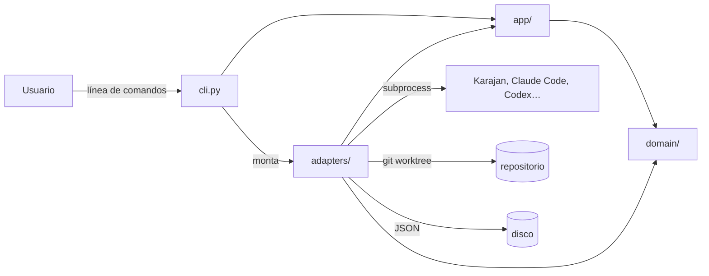

# Arquitectura de ia-testing

> Última revisión: 2026-10-19 · Responsable: @aitormf

## 1. Propósito y alcance

ia-testing es una CLI local para comparar cómo resuelven tareas de programación distintos agentes de IA. Lanza la misma tarea contra varios *runners* y recoge los resultados para compararlos. La primera versión usa [Karajan Code](https://karajancode.com); el diseño permite añadir más tareas y llamar directamente a las CLIs de los agentes (Claude Code, Codex, Gemini CLI…).

**Fuera de alcance:** no es un servicio ni tiene interfaz web; todo se ejecuta en la máquina de quien la usa. No instala ni gestiona las herramientas externas ni sus credenciales: da por hecho que ya están en el sistema.

**Ejes de crecimiento:** 1) runners (con qué se ejecuta la tarea) y 2) tareas (qué trabajos se comparan). El requisito principal es poder ampliar sin perder simplicidad.

## 2. Visión general



## 3. Mapa del código

| Ruta | Responsabilidad | Notas |
|---|---|---|
| `src/ia_testing/domain/` | `Task`, `RunResult`, `Comparison`; los Protocols `Runner`, `Workspace`, `ResultStore` y `TaskFileSource`; y `task_file.py` (modelo y validación del fichero de tarea: `parse_task_file()`) | Python puro: sin E/S ni `subprocess` |
| `src/ia_testing/app/` | Casos de uso: `run_comparison()`, `list_runners()` | Solo depende de `domain` |
| `src/ia_testing/adapters/runners/` | Un fichero por runner (`karajan.py`, más adelante `claude.py`, `codex.py`…) y el registro de runners (`registry.py`: `RUNNER_NAMES`) | Único sitio donde se llama a herramientas externas |
| `src/ia_testing/adapters/workspace/` | Creación y limpieza del `git worktree` de cada ejecución | Implementa `Workspace`; llama a `git` por `subprocess` |
| `src/ia_testing/adapters/storage/` | Persistencia de resultados en JSON en disco | Implementa `ResultStore` |
| `src/ia_testing/adapters/report/` | Salida por terminal (Rich) y Markdown | |
| `src/ia_testing/cli.py` | cyclopts: parsea, monta los adapters y llama a `app` | Sin lógica |
| `tests/` | Tests con un runner falso que implementa `Runner` | Los que usan herramientas reales llevan marcador y no se ejecutan por defecto |
| `scripts/check.sh` | Verificación completa (lo mismo que CI) | |

**¿Dónde va algo nuevo?**
- Un runner nuevo: un fichero en `adapters/runners/` más una línea en el registro. `domain` y `app` no cambian.
- Una regla de comparación: `domain/`.
- Un flujo nuevo que orquesta runners, almacenamiento e informe: un caso de uso en `app/`.
- Un formato de salida nuevo: `adapters/report/`.

## 4. Capas y reglas de dependencia

```
cli  ──►  adapters  ──►  app  ──►  domain
```

- `domain` no importa nada del proyecto; solo la stdlib.
- `app` depende de `domain` y de los Protocols que este define, nunca de `adapters`.
- `adapters` implementan los Protocols de `domain`.
- `cli.py` es el único punto que conoce a la vez a `adapters` y a `app`: monta las piezas y delega.

**Cómo se verifica:** contratos de import-linter en `pyproject.toml` (`[tool.importlinter]`), que se ejecutan en `scripts/check.sh` y en CI. Motivo: [ADR-0001](adr/0001-arquitectura-hexagonal-ligera.md).

## 5. Principios innegociables

Romper uno exige un ADR nuevo que lo cambie, no una excepción silenciosa.

| ID | Principio | Por qué | Cómo se verifica |
|---|---|---|---|
| P1 | `domain` es Python puro: no importa nada del proyecto ni hace E/S | La lógica de comparación se testea sin herramientas instaladas ([ADR-0001](adr/0001-arquitectura-hexagonal-ligera.md)) | import-linter |
| P2 | Las dependencias van en una sola dirección: `cli → adapters → app → domain` | No acoplarse a Karajan ni a ningún runner ([ADR-0001](adr/0001-arquitectura-hexagonal-ligera.md)) | import-linter |
| P3 | Las llamadas a herramientas externas (`subprocess`) solo existen en `adapters/` | Es el punto más frágil: se rompe con cada cambio de versión de las herramientas | import-linter (contrato `forbidden` de `subprocess` en `domain` y `app`) |
| P4 | `cli.py` es fino: solo parsea, monta adapters y delega en `app` | Un cambio de framework de CLI afecta a un único fichero ([ADR-0002](adr/0002-cyclopts-framework-cli.md)) | Revisión de PR |
| P5 | Añadir un runner no modifica `domain` ni `app` | Es el eje de crecimiento principal ([ADR-0001](adr/0001-arquitectura-hexagonal-ligera.md)) | Revisión de PR |
| P6 | Los tests por defecto no necesitan herramientas externas: se usa un runner falso que implementa `Runner`, nunca un parche de `subprocess` | Tests rápidos y reproducibles en cualquier máquina y en CI | pytest: los tests con herramientas reales llevan marcador y se excluyen por defecto |
| P7 | Test primero: el test se escribe y se ve en rojo antes de implementar | Los tests son el oráculo de personas y agentes | Revisión de PR y cobertura mínima en CI |
| P8 | Ninguna dependencia nueva sin aprobación humana y sin un ADR en la misma PR | Superficie de ataque y mantenimiento | Revisión de `pyproject.toml` y `uv.lock` en la PR |

## 6. Invariantes

- Cada ejecución de un runner trabaja en un `git worktree` propio, creado para esa ejecución; nunca en el working tree de quien lanza la CLI ([ADR-0005](adr/0005-git-worktree-por-ejecucion.md)).
- Los worktrees se conservan al terminar para poder inspeccionar lo que hizo cada agente; su ruta queda en el `RunResult`. Solo se borran con el comando de limpieza explícito.
- La CLI no lee, guarda ni registra credenciales de las herramientas externas: las heredan del entorno.
- Los resultados en disco no contienen variables de entorno.
- No hay descubrimiento dinámico de runners: el registro es una lista explícita en `adapters/runners/` (los *entry points* se descartaron, ver [ADR-0001](adr/0001-arquitectura-hexagonal-ligera.md)).

## 7. Flujo principal

1. `cli.py` parsea la tarea y los runners pedidos, y monta los adapters (runners, storage, report).
2. `app.run_comparison()` recibe la `Task` y los `Runner` a través de los Protocols de `domain`.
3. Para cada runner se crea un `git worktree`; el runner ejecuta la tarea en él y devuelve un `RunResult`.
4. `domain` construye la `Comparison` a partir de los `RunResult`.
5. `app` persiste los resultados mediante `ResultStore`.
6. `cli.py` pasa la comparación al adapter de informe (Rich o Markdown).

## 8. Glosario

| Término | Significado | En el código |
|---|---|---|
| Tarea | Trabajo de programación que se lanza igual contra varios runners | `domain.Task` |
| Runner | Herramienta que ejecuta una tarea: Karajan o, más adelante, la CLI de un agente | Protocol `domain.Runner`; implementaciones en `adapters/runners/` |
| Resultado | Lo que produce un runner al ejecutar una tarea | `domain.RunResult` |
| Comparación | Conjunto de resultados de la misma tarea en varios runners | `domain.Comparison` |
| Espacio de trabajo | `git worktree` aislado donde un runner ejecuta una tarea | Protocol `domain.Workspace`; implementación en `adapters/workspace/` |
| Almacén de resultados | Dónde se guardan los resultados | Protocol `domain.ResultStore`; JSON en `adapters/storage/` |

## 9. Integraciones externas

| Sistema | Para qué | Adaptador | Fallo esperado y cómo se gestiona |
|---|---|---|---|
| Karajan Code | Primer runner | `adapters/runners/karajan.py` | Herramienta ausente o cambio de versión que rompe el parsing: el runner devuelve un resultado fallido con el motivo, sin abortar el resto de la comparación |
| git | Crear un `git worktree` por ejecución | `adapters/workspace/` | Fuera de un repositorio git o fallo al crear el worktree: error claro antes de lanzar ningún runner |
| CLIs de agentes (futuro) | Runners directos | `adapters/runners/<agente>.py` | Igual que Karajan |

## 10. Aspectos transversales

- **Errores:** los fallos de una herramienta externa se convierten en el adapter en un `RunResult` fallido; no se propagan excepciones de `subprocess` fuera de `adapters/`.
- **Seguridad:** ver las invariantes de la §6 y [`SECURITY.md`](../SECURITY.md).
- **Configuración:** la resuelve cyclopts (argumentos, variables de entorno y TOML) en `cli.py`.
- **Tests:** unitarios con runner falso y `tmp_path` real para el storage; los de integración con herramientas reales van marcados y son opcionales.

## 11. Decisiones

Las decisiones con su contexto y las alternativas descartadas están en [`docs/adr/`](adr/README.md). Este documento describe **cómo será** el sistema; los ADRs explican **por qué**.

Decisiones aplazadas:

| Tema | Disparador para decidir |
|---|---|
| Nombre del paquete y del comando | Antes de la primera publicación |
| Publicación en PyPI | Cuando la idea esté madura y haya nombre |
| Plugins por *entry points* | Demanda de runners mantenidos fuera del repo |

## 12. Mantenimiento de este documento

- Se actualiza **en la misma PR** que cambie la estructura, una capa, un principio o una integración.
- Cambiar un principio de la §5 exige un ADR.
- Se contrasta con el código cada trimestre.
