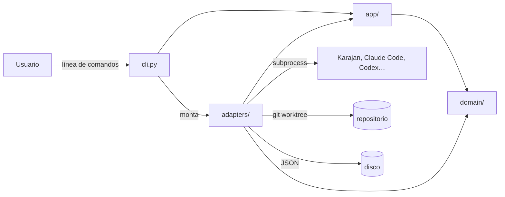

# Arquitectura de ia-testing

> Última revisión: 2026-10-20 · Responsable: @aitormf

## 1. Propósito y alcance

ia-testing es una CLI local para comparar cómo resuelven tareas de programación distintos agentes de IA. Lanza la misma tarea contra varios *runners* y recoge los resultados para compararlos. El primer runner implementado es [Claude Code](https://claude.com/claude-code), que se lanza directamente como CLI; el registro ya reserva `codex` y `opencode`, y el diseño permite añadir más runners (Karajan Code, Gemini CLI…) y más tareas.

**Fuera de alcance:** no es un servicio ni tiene interfaz web; todo se ejecuta en la máquina de quien la usa. No instala ni gestiona las herramientas externas ni sus credenciales: da por hecho que ya están en el sistema.

**Ejes de crecimiento:** 1) runners (con qué se ejecuta la tarea) y 2) tareas (qué trabajos se comparan). El requisito principal es poder ampliar sin perder simplicidad.

## 2. Visión general



## 3. Mapa del código

| Ruta | Responsabilidad | Notas |
|---|---|---|
| `src/ia_testing/domain/` | `Task`, `RunResult`, `Comparison`; los Protocols `Runner`, `Workspace`, `ResultStore` y `TaskFileSource`; y `task_file.py` (modelo y validación del fichero de tarea: `parse_task_file()`) | Python puro: sin E/S ni `subprocess` |
| `src/ia_testing/app/` | Casos de uso: `validate_task_file()`; `run.py`: `run_task()` (comprobaciones previas, worktrees, ejecución secuencial de las configuraciones y `results.json` tras cada una), `RunOptions` y `RunOutcome`; más adelante `run_comparison()` y `list_runners()` | Solo depende de `domain`. Recibe los runners como `Mapping[str, Runner \| None]` (`None` = no implementado): no conoce nombres de runners |
| `src/ia_testing/adapters/runners/` | Un fichero por runner (`claude.py`: `ClaudeRunner` y las funciones puras `build_argv()`, `build_env()` y `parse_result()`, que devuelve el `OutputSummary` común a todos los runners (`_summary.py`); más adelante `codex.py`, `opencode.py`, `karajan.py`…) y el registro de runners (`registry.py`: `RUNNERS`, que asocia cada nombre con su clase o con `None` si no está implementado; `RUNNER_NAMES = tuple(RUNNERS)` y `build_runners()`) | Único sitio donde se llama a herramientas externas. Un runner nuevo es un fichero más cambiar su `None` en `RUNNERS` |
| `src/ia_testing/adapters/runners/_process.py` | `run_logged()`: lanza el proceso de un runner en su propio grupo de procesos (sin shell, con el entorno exacto que se le da y el prompt por stdin), vuelca stdout y stderr en ficheros separados enmascarando los secretos (`***`), aplica el timeout y devuelve un `ProcessResult` (`returncode`, `timed_out`, `start_error`) | Lo usan todos los runners de CLI. Al terminar, sea por salida normal, timeout o Ctrl-C, envía SIGTERM al grupo, espera 5 s y envía SIGKILL, de modo que no sobrevive ningún descendiente; espera como máximo 5 s a cada hilo de E/S y vuelve a lanzar `KeyboardInterrupt` tras limpiar. Un proceso que escape del grupo (`setsid`) no se termina |
| `src/ia_testing/adapters/task_file.py` | `TomlTaskFileSource`: lee el fichero de tarea (TOML) y convierte cualquier fallo de lectura o de sintaxis en `InvalidTaskFile` | Implementa `TaskFileSource`; no es configuración de la CLI (ver §10) |
| `src/ia_testing/adapters/workspace/` | `git.py`: `GitWorkspace` abre el repositorio, resuelve la ref a un commit, detecta cambios sin commitear y crea el `git worktree` y la rama de cada configuración (la limpieza llegará con su comando) | Implementa `Workspace`; llama a `git` por `subprocess`: lista de argumentos, sin shell, timeout de 60 s y cualquier fallo convertido en `WorkspaceError` con un motivo fijo |
| `src/ia_testing/adapters/storage/` | `json_store.py`: `JsonResultStore` crea el directorio de cada ejecución en exclusiva y escribe `results.json` (`schema_version: 1`) | Implementa `ResultStore`; la escritura es atómica (temporal y renombrado) y un `OSError` se convierte en `StoreError` |
| `src/ia_testing/adapters/report/` | Salida por terminal (Rich) y Markdown; `validation.py` escribe el resultado de `validate` y `run.py` (`print_run()`) el resumen de `run`; ambos devuelven el código de salida | |
| `src/ia_testing/cli.py` | cyclopts: parsea, monta los adapters y llama a `app` (`validate` y `run`). `main()` instala el manejador que convierte SIGTERM y SIGHUP en `KeyboardInterrupt` | Sin lógica |
| `tests/` | Tests con un runner falso que implementa `Runner` (`fake_runner.py`) y, para los adapters que lanzan procesos, ejecutables o scripts falsos que generan los propios tests en `tmp_path` (`fakes.py`: el `claude` falso) | Nunca se parchea `subprocess`. Los que usan herramientas reales llevan marcador y no se ejecutan por defecto |
| `scripts/check.sh` | Verificación completa (lo mismo que CI) | |

**¿Dónde va algo nuevo?**
- Un runner nuevo: un fichero en `adapters/runners/` más una línea en el registro. `domain` y `app` no cambian.
- Una regla de comparación: `domain/`.
- Un flujo nuevo que orquesta runners, almacenamiento e informe: un caso de uso en `app/`.
- Un formato de salida nuevo: `adapters/report/`.

## 4. Capas y reglas de dependencia

```
cli  ──►  adapters  ──►  app  ──►  domain
```

- `domain` no importa nada del proyecto; solo la stdlib.
- `app` depende de `domain` y de los Protocols que este define, nunca de `adapters`.
- `adapters` implementan los Protocols de `domain`.
- `cli.py` es el único punto que conoce a la vez a `adapters` y a `app`: monta las piezas y delega.

**Cómo se verifica:** contratos de import-linter en `pyproject.toml` (`[tool.importlinter]`), que se ejecutan en `scripts/check.sh` y en CI. Motivo: [ADR-0001](adr/0001-arquitectura-hexagonal-ligera.md).

## 5. Principios innegociables

Romper uno exige un ADR nuevo que lo cambie, no una excepción silenciosa.

| ID | Principio | Por qué | Cómo se verifica |
|---|---|---|---|
| P1 | `domain` es Python puro: no importa nada del proyecto ni hace E/S | La lógica de comparación se testea sin herramientas instaladas ([ADR-0001](adr/0001-arquitectura-hexagonal-ligera.md)) | import-linter |
| P2 | Las dependencias van en una sola dirección: `cli → adapters → app → domain` | No acoplarse a Karajan ni a ningún runner ([ADR-0001](adr/0001-arquitectura-hexagonal-ligera.md)) | import-linter |
| P3 | Las llamadas a herramientas externas (`subprocess`) solo existen en `adapters/` | Es el punto más frágil: se rompe con cada cambio de versión de las herramientas | import-linter (contrato `forbidden` de `subprocess` en `domain` y `app`) |
| P4 | `cli.py` es fino: solo parsea, monta adapters y delega en `app` | Un cambio de framework de CLI afecta a un único fichero ([ADR-0002](adr/0002-cyclopts-framework-cli.md)) | Revisión de PR |
| P5 | Añadir un runner no modifica `domain` ni `app` | Es el eje de crecimiento principal ([ADR-0001](adr/0001-arquitectura-hexagonal-ligera.md)) | Revisión de PR |
| P6 | Los tests por defecto no necesitan herramientas externas reales. Los dobles permitidos son un runner falso que implementa `Runner`, ejecutables o scripts falsos generados por los propios tests en `tmp_path`, y subclases de un adapter real que solo inyectan un fallo y delegan todo lo demás. Nunca se parchea `subprocess` | Tests rápidos y reproducibles en cualquier máquina y en CI ([ADR-0006](adr/0006-dobles-de-test-para-adapters.md)) | pytest: los tests con herramientas reales llevan marcador y se excluyen por defecto |
| P7 | Test primero: el test se escribe y se ve en rojo antes de implementar | Los tests son el oráculo de personas y agentes | Revisión de PR y cobertura mínima en CI |
| P8 | Ninguna dependencia nueva sin aprobación humana y sin un ADR en la misma PR | Superficie de ataque y mantenimiento | Revisión de `pyproject.toml` y `uv.lock` en la PR |

## 6. Invariantes

- Cada ejecución de un runner trabaja en un `git worktree` propio, creado para esa ejecución; nunca en el working tree de quien lanza la CLI ([ADR-0005](adr/0005-git-worktree-por-ejecucion.md)).
- Los worktrees se conservan al terminar para poder inspeccionar lo que hizo cada agente; su ruta queda en el `RunResult`. Solo se borran con el comando de limpieza explícito.
- La CLI elige qué variables de entorno recibe el agente: una lista cerrada de variables de funcionamiento y de credenciales (`ANTHROPIC_API_KEY` y `CLAUDE_CODE_OAUTH_TOKEN` para Claude Code). Enmascara (`***`) los valores de esas credenciales en los logs del agente y nunca las guarda en otro sitio. No lee ficheros de credenciales de las herramientas. Lo que el agente lea por su cuenta (ficheros, otras fuentes) queda fuera de esta garantía: los logs pueden contener datos sensibles.
- Los resultados en disco no contienen variables de entorno.
- No hay descubrimiento dinámico de runners: el registro es una lista explícita en `adapters/runners/` (los *entry points* se descartaron, ver [ADR-0001](adr/0001-arquitectura-hexagonal-ligera.md)).

## 7. Flujo principal

Es el de `run_task()`; todavía no se construye una `Comparison`.

1. `cli.py` parsea los argumentos y monta los adapters (fichero de tarea, runners, workspace, storage, informe).
2. `app.run_task()` valida el fichero de tarea con las reglas de `validate`; abre el repositorio y resuelve la ref a un commit.
3. Cada runner implementado que usa el fichero comprueba que su herramienta está disponible (`Runner.check()`); los avisos se emiten en cuanto aparecen. Si el repositorio tiene cambios sin commitear, también se avisa.
4. `ResultStore.create_run()` crea el directorio de la ejecución y `Workspace.create()` crea, antes de lanzar ningún runner, un `git worktree` y una rama por cada configuración con runner implementado. Cualquier fallo hasta aquí termina con código 2 sin lanzar nada; los worktrees ya creados se conservan y se listan en el error.
5. Para cada configuración, en el orden del fichero, el runner ejecuta la tarea en su worktree y devuelve una `Execution`; `app` la compone en un `RunResult` y `ResultStore.save()` reescribe `results.json`. Una configuración con un runner no implementado queda como fallida sin worktree; un fallo de una configuración no detiene las demás.
6. Una interrupción (Ctrl-C) durante la ejecución marca la configuración en curso y las pendientes como `interrupted` y guarda lo hecho (código 1); antes de empezar termina con código 2. Si `save` falla se deja de ejecutar (código 1).
7. `cli.py` pasa el `RunOutcome` al adapter de informe, que escribe el resumen y devuelve el código de salida.

## 8. Glosario

| Término | Significado | En el código |
|---|---|---|
| Tarea | Trabajo de programación que se lanza contra varios runners: mismo tipo de trabajo para todos y, por defecto, el mismo prompt; cada configuración de runner puede ajustar el prompt | `domain.Task` |
| Runner | Herramienta que ejecuta una tarea: la CLI de un agente (Claude Code, más adelante Codex, OpenCode…) o Karajan | Protocol `domain.Runner`; implementaciones en `adapters/runners/` |
| Fichero de tarea | Fichero TOML que describe una tarea y los runners con los que se lanza: `type`, un `prompt` común opcional y la lista `[[runners]]`. Esquema en [`config_file.md`](config_file.md) | `domain.TaskFile`; lectura en `adapters/task_file.py` |
| Configuración de runner | Cada elemento de `[[runners]]`: `id`, `runner`, `model`, `local` y `prompt` opcional. Su prompt efectivo es el propio o, si no tiene, el común | `domain.RunnerConfig` |
| Resultado | Lo que produce un runner al ejecutar una tarea | `domain.RunResult` |
| Comparación | Conjunto de resultados de la misma tarea en varios runners | `domain.Comparison` |
| Espacio de trabajo | `git worktree` aislado donde un runner ejecuta una tarea | Protocol `domain.Workspace`; implementación en `adapters/workspace/` |
| Almacén de resultados | Dónde se guardan los resultados | Protocol `domain.ResultStore`; JSON en `adapters/storage/` |

## 9. Integraciones externas

| Sistema | Para qué | Adaptador | Fallo esperado y cómo se gestiona |
|---|---|---|---|
| Claude Code | Primer runner (`claude -p`, salida `stream-json`) | `adapters/runners/claude.py` | Herramienta ausente (error con código 2 antes de crear nada), no autenticada, código de salida distinto de 0, `is_error`, timeout o cambio de formato que impide leer coste y tokens: el runner devuelve un resultado fallido con un motivo fijo (o deja coste y tokens vacíos), sin abortar el resto de la ejecución. Se lanza sin restricciones de permisos (`bypassPermissions`) y con un entorno mínimo |
| Karajan Code (futuro) | Runner | `adapters/runners/karajan.py` | Igual que Claude Code |
| git | Crear un `git worktree` por ejecución | `adapters/workspace/` | Fuera de un repositorio git, `git` ausente o fallo al crear el worktree: error claro antes de lanzar ningún runner. Todos los worktrees de una ejecución se crean antes de lanzar el primer runner. Se crean sin hooks (`core.hooksPath=/dev/null`) ni Git LFS (`GIT_LFS_SKIP_SMUDGE=1`) y no se inicializan submódulos |
| CLIs de agentes (futuro) | Runners directos (Codex, OpenCode…) | `adapters/runners/<agente>.py` | Igual que Claude Code |

## 10. Aspectos transversales

- **Errores:** los fallos de una herramienta externa se convierten en el adapter en un `RunResult` fallido; no se propagan excepciones de `subprocess` fuera de `adapters/`.
- **Seguridad:** ver las invariantes de la §6 y [`SECURITY.md`](../SECURITY.md).
- **Configuración:** la resuelve cyclopts (argumentos, variables de entorno y TOML) en `cli.py`.
- **Fichero de tarea:** es un dato de entrada de los comandos `validate` y `run`, no configuración de la CLI: no lo resuelve cyclopts. `cli.py` solo recibe su ruta (`Path`); lo lee `adapters/task_file.py` y lo valida `domain` sin E/S.
- **Tests:** unitarios con runner falso y `tmp_path` real para el storage. Los adapters que lanzan procesos (`_process.py`, y los runners) se prueban con ejecutables o scripts falsos que generan los tests en `tmp_path` (por ejemplo, scripts Python lanzados con `sys.executable`); no se parchea `subprocess`. Se permite una subclase de un adapter real que solo inyecta un fallo y delega todo lo demás (por ejemplo, `InterruptingWorkspace` en `test_app_run.py`). Los de integración con herramientas reales van marcados y son opcionales.

## 11. Decisiones

Las decisiones con su contexto y las alternativas descartadas están en [`docs/adr/`](adr/README.md). Este documento describe **cómo será** el sistema; los ADRs explican **por qué**.

Decisiones aplazadas:

| Tema | Disparador para decidir |
|---|---|
| Nombre del paquete y del comando | Antes de la primera publicación |
| Publicación en PyPI | Cuando la idea esté madura y haya nombre |
| Plugins por *entry points* | Demanda de runners mantenidos fuera del repo |

## 12. Mantenimiento de este documento

- Se actualiza **en la misma PR** que cambie la estructura, una capa, un principio o una integración.
- Cambiar un principio de la §5 exige un ADR.
- Se contrasta con el código cada trimestre.
